<div align="center">

<a href="https://ibl.ai"></a>

# ibl.ai/recruit

**The open-source recruitment CRM for universities — run by a Chief of Staff agent.**

One agent your whole admissions team talks to. Prospects, schools, applications, activities and tags in the shape of a modern CRM. Landing pages that turn a QR code at a college fair into a prospect in your funnel. Built on the [ibl.ai](https://ibl.ai) platform with [iblai/vibe](https://github.com/iblai/vibe).

[](https://ibl.ai/join)
[](https://ibl.ai)
[](https://ibl.ai/docs)
[](LICENSE)
[](https://ibl.ai)
[](https://github.com/iblai/vibe)
[](https://nextjs.org)
[](https://tauri.app)

<br>

### ⬇️ Get ibl.ai/recruit


&nbsp;

&nbsp;


<a href="docs/platform-deployment.md#6-ios"></a>
&nbsp;
<a href="docs/platform-deployment.md#7-android"></a>

<sub>Hosted web app and published builds coming soon · today: [run it locally](#quick-start) or [deploy it yourself](#deployment) · [how builds are made](docs/DOWNLOADS.md)</sub>

<br>

[Why ibl.ai/recruit](#why-iblairecruit) · [Every platform](#every-platform-one-codebase) · [Features](#features) · [Case studies](#case-studies) · [Screenshots](#screenshots) · [Quick Start](#quick-start) · [Deployment](#deployment) · [Architecture](#architecture)

</div>

---

<div align="center">

**SOC 2 Type II** &nbsp;·&nbsp; Universities, enterprises, and governments run on ibl.ai — [read the case studies →](https://ibl.ai/case-studies)

</div>

---

## Why ibl.ai/recruit

|                                  |                                                                                                                                                                                                                                                                                 |
| -------------------------------- | ------------------------------------------------------------------------------------------------------------------------------------------------------------------------------------------------------------------------------------------------------------------------------- |
| 🧭 **An agent, not a dashboard** | Home is a conversation. The **Chief of Staff** knows every prospect, school and application, briefs the team each morning, logs the calls, moves the applications, drafts the outreach and builds the landing pages — through tools, against the same records the screens show. |
| 🗂️ **A real CRM underneath**     | A modern CRM's information architecture — objects in a sidebar, table and kanban views, record pages with a timeline — on the ibl.ai CRM API, in admissions vocabulary: prospects, schools, applications in funnels, counselors.                                                |
| 🌐 **Prospect-facing pages**     | Publish "Request information" or event pages at `/p/<org>/<slug>`: fast, server-rendered, no sign-in. Every submission lands as a prospect — with an application in the funnel, tags and a note.                                                                                |
| 🔓 **Your code, your data**      | MIT-licensed and self-hostable. Records live in your ibl.ai organization, scoped by the platform's multi-tenancy — no second database. SSO, roles, notifications, memory, analytics and billing come from the platform.                                                         |
| 📱 **Everywhere**                | One codebase ships as web, macOS, Windows, Linux, iOS and Android (Tauri 2 shells), exactly like [iblai/os](https://github.com/iblai/os) and [iblai/crm](https://github.com/iblai/crm).                                                                                         |

---

## Every platform, one codebase

ibl.ai/recruit meets your admissions team wherever they are — the same product, native everywhere.

<div align="center">

| Platform    |     | Status                                                                                                                                                     |
| ----------- | --- | ---------------------------------------------------------------------------------------------------------------------------------------------------------- |
| **Web**     | 🌐  | Coming soon at **recruit.ibl.ai** — today, [run it locally](#quick-start) or [deploy it yourself](#deployment)                                             |
| **macOS**   | 🍎  | Native app (universal .dmg, Intel + Apple Silicon) — built by the [release workflow](.github/workflows/tauri-release-macos-dmg.yml); downloads coming soon |
| **Windows** | 🪟  | Native app (x64 + ARM64 installer) — built by the [release workflow](.github/workflows/tauri-release-windows.yml); downloads coming soon                   |
| **Linux**   | 🐧  | Native app (AppImage) — built by the [desktop build workflow](.github/workflows/tauri-build-desktop.yml); downloads coming soon                            |
| **iOS**     | 📱  | Native app — built by the [iOS workflow](.github/workflows/tauri-build-ios.yml); App Store listing coming soon                                             |
| **Android** | 🤖  | Native app — built by the [Android workflow](.github/workflows/tauri-build-android.yml); Google Play listing coming soon                                   |

</div>

The native apps are [Tauri 2](https://tauri.app) WebView shells around the hosted app (`src-tauri/`), so they load recruit.ibl.ai and work once it is live — or point them at your own deployment ([docs/development.md](docs/development.md)). They are built the same way [iblai/os](https://github.com/iblai/os) and [iblai/crm](https://github.com/iblai/crm) ship. Sign-in on mobile goes through the system browser and returns via the `iblai-recruit://` deep link. See [docs/platform-deployment.md](docs/platform-deployment.md).

---

## Features

<table>
<tr>
<td width="50%" valign="top">

**🧭 The Chief of Staff**

- **One agent for the whole team** — an ordinary ibl.ai agent (prompts, LLM, memory, guardrails and analytics tuned in the Agentic OS) with this app's tool server: what it looks up and changes is what the screens show
- **Today's brief** — open applications by stage, due today and overdue, inquiries this week, stale applications, deadlines
- **Tools, not tabs** — search, create and update prospects, schools and applications; log activities, complete tasks, tag records; draft landing pages that stay unpublished until a human reviews them
- **Everywhere** — Home is the full conversation with today's brief beside it; a **Chief of Staff** button opens the same agent in a side panel on every other page
- **One-click setup** — an org admin opens _Settings → Chief of Staff_: the agent, its tool server and its scoped key are created for the organization

**👥 Prospects & schools**

- **Prospects** — students, applicants and school contacts with lifecycle stage, counselor, contact details and the recruitment fields the API has no column for (graduation year, entry term, entry type, residency, GPA, parent contact, SMS consent)
- **Schools & partners** — high schools, colleges, CBOs, agencies and employers, with their type, prospects, applications and timeline
- **Invite · link · merge** — turn a prospect into a platform user by email invitation, link one to an existing user, or merge duplicates
- **Tags & sources** — labels shared across records; college fair, school visit, landing page and the other sources

</td>
<td width="50%" valign="top">

**🗂️ Applications & funnels**

- **Board** — drag applications between funnel stages; stale and deadline badges
- **Table** — the same applications as a list
- **Application page** — stage stepper, mark enrolled / withdrawn (with a reason), program, term, entry type, financial aid, scholarship, timeline
- **Funnels** — a new organization starts with none; an admin creates the admissions funnel from _Applications_ in one click, with stable stage codes (`applied`, …)
- **Activities** — calls, meetings, emails, notes and tasks on every record; overdue / today / this week

**🌐 Landing pages**

- **Build** — copy, highlights, hero image, the form's questions and where each answer lands, routing into a funnel stage with source, tags and counselor
- **Publish** — live at `/p/<org>/<slug>`: fast, server-rendered, no sign-in; a share link, UTM guidance and an embed snippet
- **Every submission is a prospect** — with an application in the funnel, tags and a note; identical answers within ten minutes count once, a honeypot drops bots

**🏢 Operate & scale**

- **Multi-organization** — the organization is in the URL (`/platform/<org>/…`); Recruit keeps to its own records, apart from the ibl.ai CRM's on the same organization
- **SSO & roles** — ibl.ai sign-in; org admins run the setup and build the pages; the agent acts with the CRM User role
- **The OS shell** — the SDK's `PlatformSidebar` with the organization's logo and the OS footer cluster (Notifications, Invites, Management, Integrations, Monetization, Advanced, Support)
- **⌘K** — the command palette
- **Native shells** — macOS, Windows, Linux and iOS via Tauri 2; Android and published builds coming soon

</td>
</tr>
</table>

---

## The Chief of Staff

Every member of the recruitment team — counselors, recruiters, operations, the director — works through one agent. It is an ordinary ibl.ai agent (prompts, LLM, memory, guardrails and analytics are tuned in the Agentic OS) with one addition: this app exposes a **tool server** the agent calls, so what it looks up and changes is what the team sees.

```
"Give me today's brief."
"Who in Admitted hasn't deposited, and when did we last talk to them?"
"Log that I toured campus with Priya Natarajan on Tuesday and schedule a follow-up for Friday."
"Draft a warm email to the Fall 2027 admits from Lincoln High who haven't deposited."
"Create a landing page for the Nursing open house — Fall 2027, tag Web inquiry."
```

**What it can do** (every tool acts with the CRM User role, or as the admin who last ran setup where RBAC is off; none deletes or merges):

| Area          | Tools                                                                                                                                  |
| ------------- | -------------------------------------------------------------------------------------------------------------------------------------- |
| The brief     | `daily_brief` — open applications by stage, due today / overdue, inquiries this week, stale applications, deadlines                    |
| Prospects     | `search_prospects`, `get_prospect`, `create_prospect`, `update_prospect`                                                               |
| Schools       | `list_schools`, `create_school`                                                                                                        |
| Applications  | `list_funnels`, `list_applications`, `create_application`, `move_application`, `mark_enrolled`, `mark_withdrawn`, `update_application` |
| Activities    | `log_activity`, `list_tasks`, `complete_task`                                                                                          |
| Tags & team   | `list_tags`, `tag_record`, `list_team`                                                                                                 |
| Landing pages | `list_landing_pages`, `create_landing_page` (drafts stay unpublished until a human reviews them)                                       |

**Where it lives:** Home (`/platform/<org>`) is the full conversation with today's brief beside it; a **Chief of Staff** button in the top bar opens the same agent in a side panel on every other page.

**Setup:** an org admin opens _Settings → Chief of Staff_ and clicks once. Acting as that admin, the server creates the agent, registers this deployment's tool server (`/api/mcp/<org>`, MCP over Streamable HTTP), mints the `recruit-tools` Platform API Token (scoped to the CRM User role where the platform enforces RBAC) and stores it in a platform-scoped connection (the platform presents it on every tool call; this app keeps no copy), wires the `mcp` tool + the server onto the agent, adds suggested prompts, and records the agent id in the organization's metadata so every member's app finds it. Re-running re-syncs the prompt and wiring, rotates the key and keeps everything else. Details: [docs/chief-of-staff.md](docs/chief-of-staff.md).

---

## The CRM: admissions words on a modern CRM

The platform's CRM API speaks sales; the app keeps those names in code and shows admissions language everywhere a human reads it ([`lib/recruit/vocabulary.ts`](lib/recruit/vocabulary.ts)):

| CRM API (code)        | ibl.ai/recruit (UI)                                      |
| --------------------- | -------------------------------------------------------- |
| Person                | **Prospect** — a student, applicant or school contact    |
| Organization          | **School** — high school, college, CBO, agency, employer |
| Deal                  | **Application** — one prospect × one program and term    |
| Pipeline / Stage      | **Funnel** / Stage (stable codes, e.g. `applied`)        |
| Lead source           | **Source** (college fair, school visit, landing page…)   |
| Owner                 | **Counselor**                                            |
| Won / Lost            | **Enrolled** / **Withdrawn** (with a reason)             |
| `lead_value`          | **Est. net tuition** (optional)                          |
| `expected_close_date` | **Decision deadline**                                    |
| `lifecycle_stage`     | Inquiry → Engaged → Applicant → Enrolled · Withdrawn     |

Recruit keeps to its own records: on an organization that also uses the ibl.ai CRM, neither sees the other's prospects, schools, applications, funnels, tags or sources (the platform's CRM 1.4.0 keeps apps apart). A new organization starts with no funnel; an admin creates the admissions funnel from _Applications_ in one click.

Recruitment fields the API has no column for — graduation year, entry term, entry type, residency, GPA, parent contact, SMS consent on prospects; program, term, entry type, financial aid, scholarship on applications; type on schools — live in each record's `metadata`, defined once in [`lib/recruit/fields.ts`](lib/recruit/fields.ts) and shared by the dialogs, the record pages, the agent's tools and the landing-page mapping.

**Screens:** Funnel dashboard (tiles, applications by stage, enrolled vs withdrawn, up next) · Prospects table and record page (details, recruitment fields, timeline, applications, invite / link / merge) · Schools & partners · Applications board (drag between stages, stale and deadline badges) and table · Application page (stage stepper, enrolled / withdrawn, fields, timeline) · Activities (overdue / today / week) · Tags · Landing pages · Settings (Chief of Staff, Funnels, Sources, Branding, About) · ⌘K. The sidebar is the SDK's cross-app `PlatformSidebar`, the same shell as os.ibl.ai: the organization's own logo in the header and the OS footer cluster (Notifications, Invites, Management, Integrations, Monetization, Advanced, Support) opening the platform's organization sheets in place.

---

## Landing pages

Admins build pages in _Landing pages_: copy, highlights, hero image, the form's questions (each mapped to where its answer lands — name, email, phone, school, program, term, graduation year, consent, or "keep as extra field"), and routing (which funnel and stage the application opens in, the source code, tags, the counselor who owns submissions). A live preview shows the page with its form; **Publish** flips the page live at `/p/<org>/<slug>`; _Share_ gives the link, UTM guidance and an embed snippet.

Each page is a CRM web form on the platform. A visitor's answers go straight to its public endpoint, which reuses the prospect with that email or creates one, opens the application, tags both and logs a note of the answers — with no credential in this app. Identical answers within ten minutes count once, a honeypot drops bots, and the list counts each page's submissions. The pages are plain server-rendered React: no session, no SDK bundle. Details: [docs/landing-pages.md](docs/landing-pages.md).

---

## Case studies

Universities, enterprises, and government agencies build on ibl.ai — deploying agents on their own infrastructure, with their own models, at a fraction of the cost of closed platforms.

**[Read the case studies →](https://ibl.ai/case-studies)**

---

## Screenshots

Captured from a demo organization ("Northfield University", seeded with `pnpm seed:demo`). Regenerate with `pnpm screenshots`.

<div align="center">

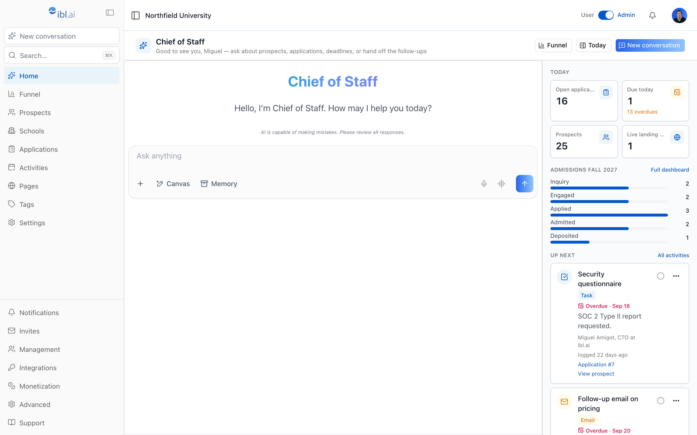

<sub>**Home** — the Chief of Staff, with today's brief beside it</sub>

<br><br>

<table>
<tr>
<td width="50%">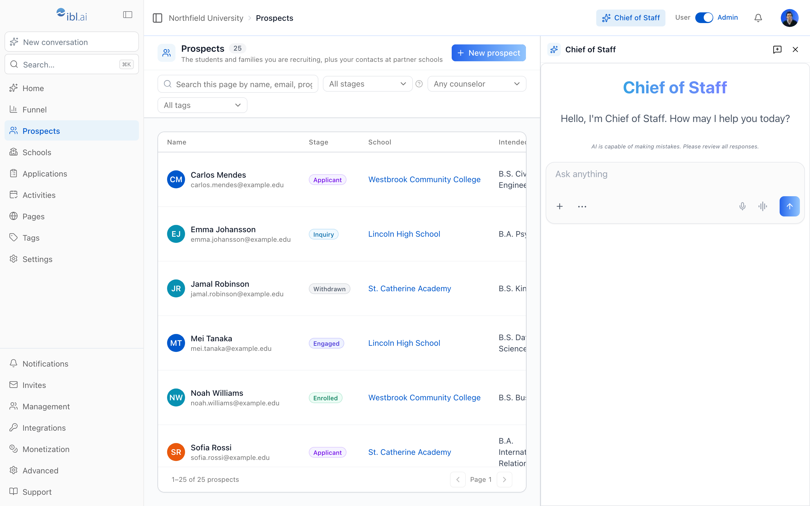<br><sub><b>Side panel</b> — the Chief of Staff follows you to every page</sub></td>
<td width="50%">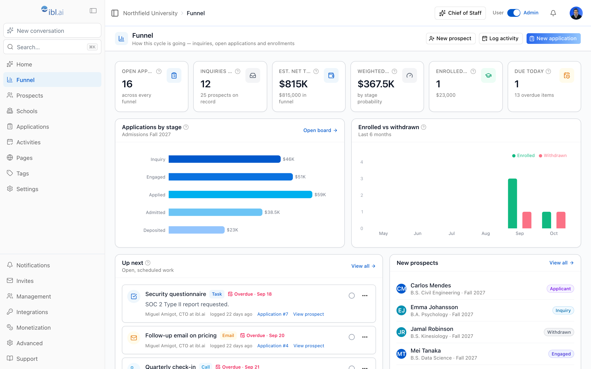<br><sub><b>Funnel dashboard</b> — tiles, applications by stage, enrolled vs withdrawn, up next</sub></td>
</tr>
<tr>
<td width="50%">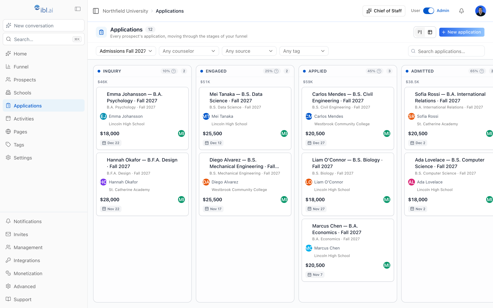<br><sub><b>Applications board</b> — drag between stages</sub></td>
<td width="50%">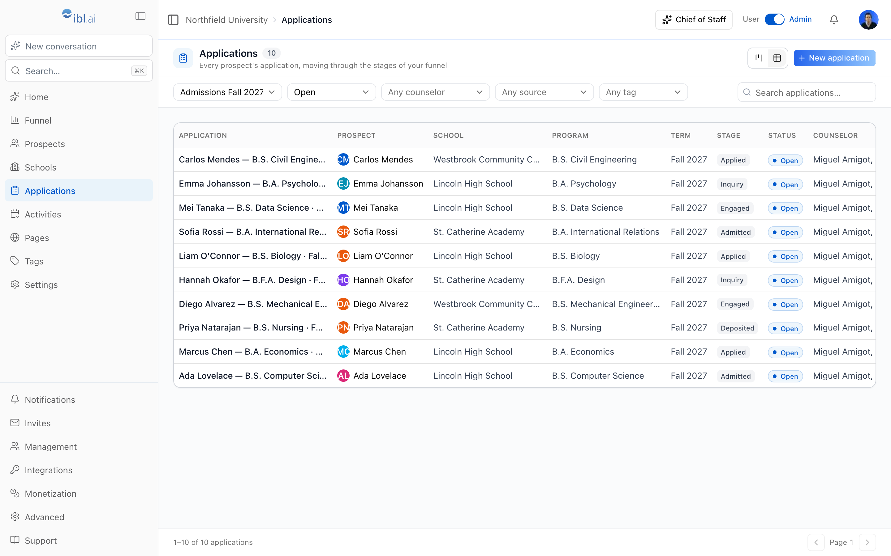<br><sub><b>Applications table</b></sub></td>
</tr>
<tr>
<td width="50%">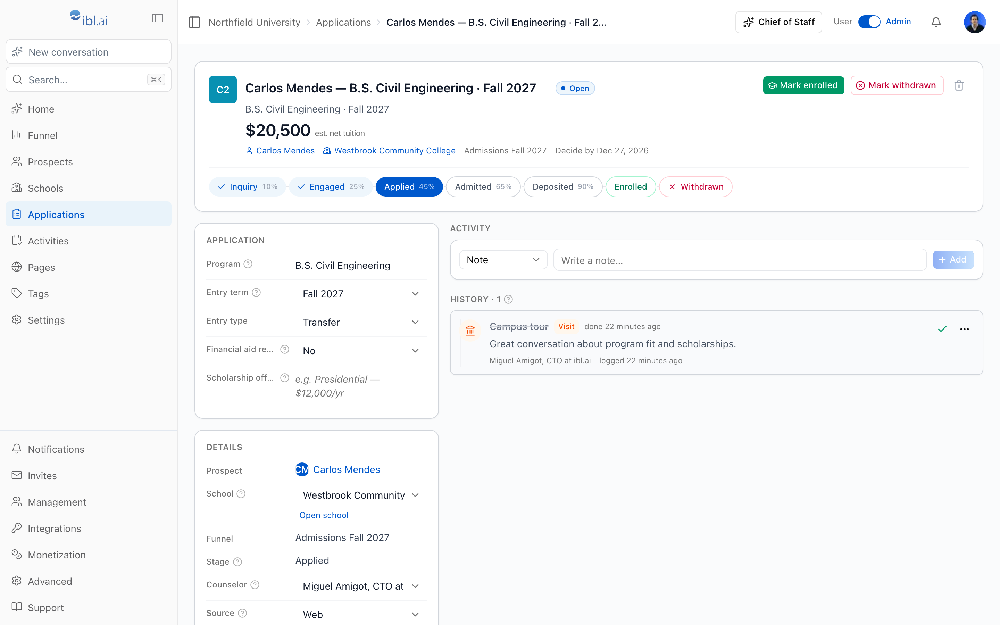<br><sub><b>An application</b> — stage stepper, enrolled / withdrawn, recruitment fields, timeline</sub></td>
<td width="50%">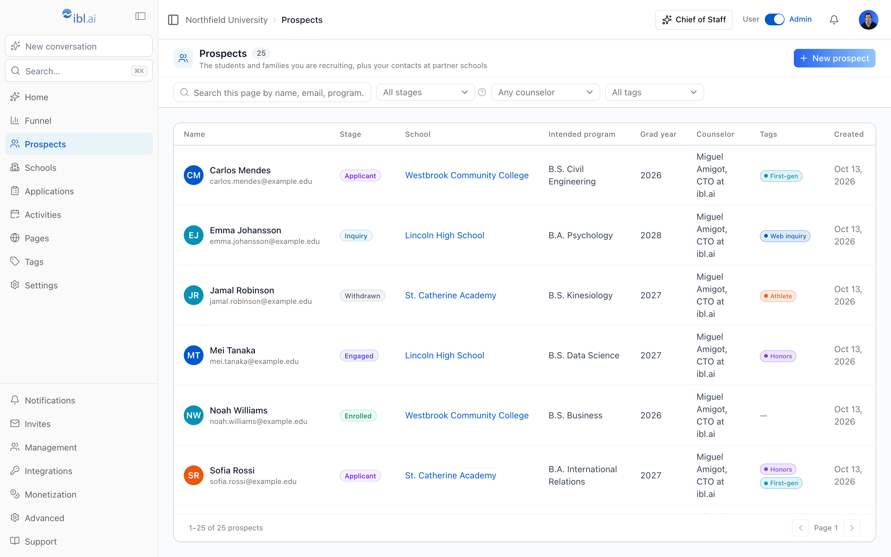<br><sub><b>Prospects</b></sub></td>
</tr>
<tr>
<td width="50%">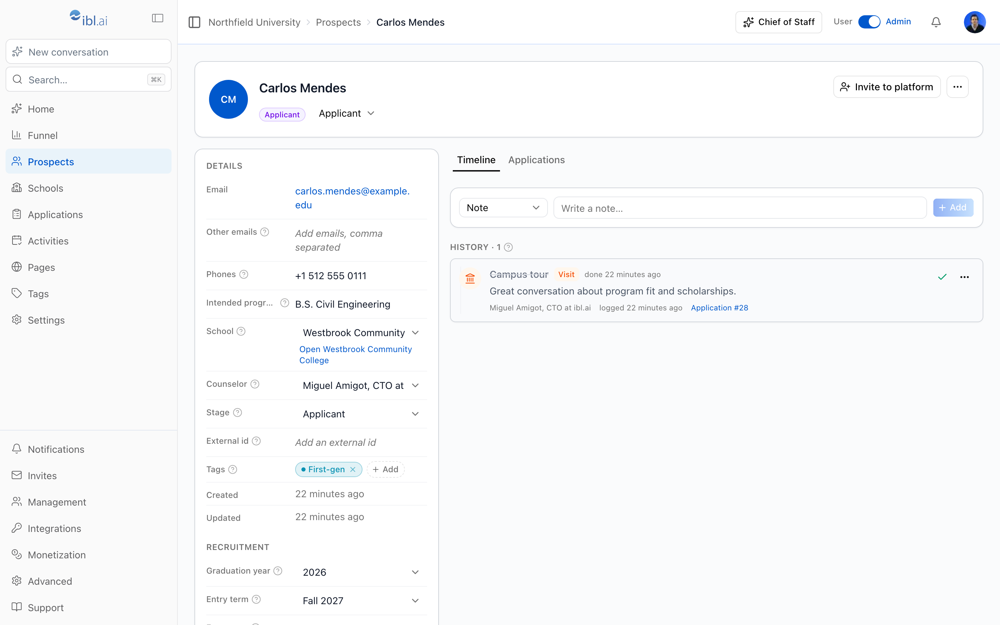<br><sub><b>A prospect</b> — recruitment fields and timeline</sub></td>
<td width="50%">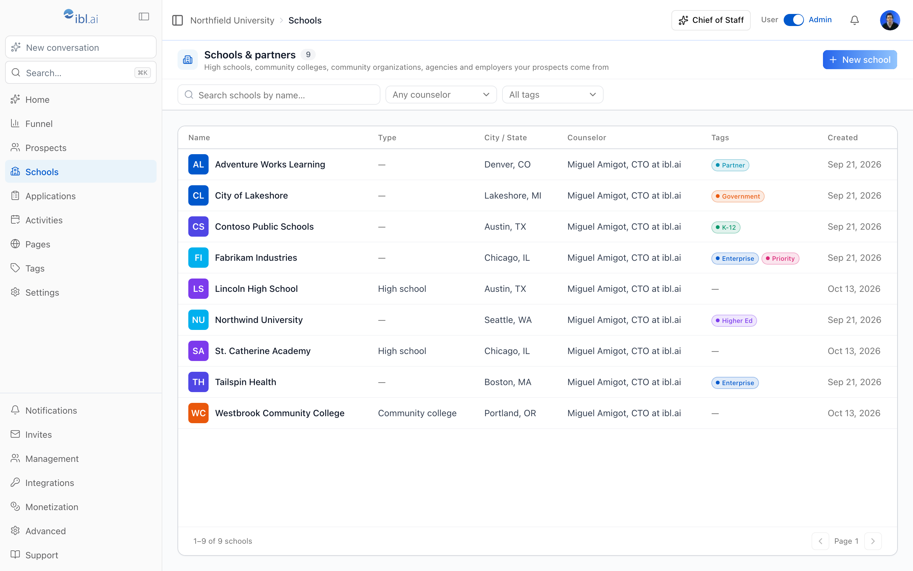<br><sub><b>Schools & partners</b></sub></td>
</tr>
<tr>
<td width="50%">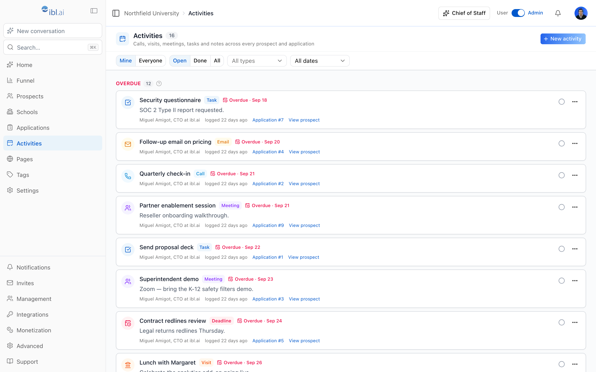<br><sub><b>Activities</b> — overdue, today, this week</sub></td>
<td width="50%">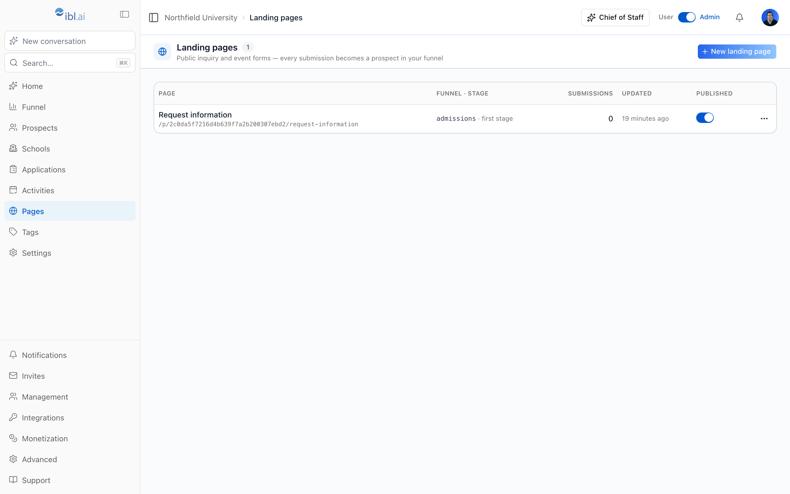<br><sub><b>Landing pages</b></sub></td>
</tr>
<tr>
<td width="50%">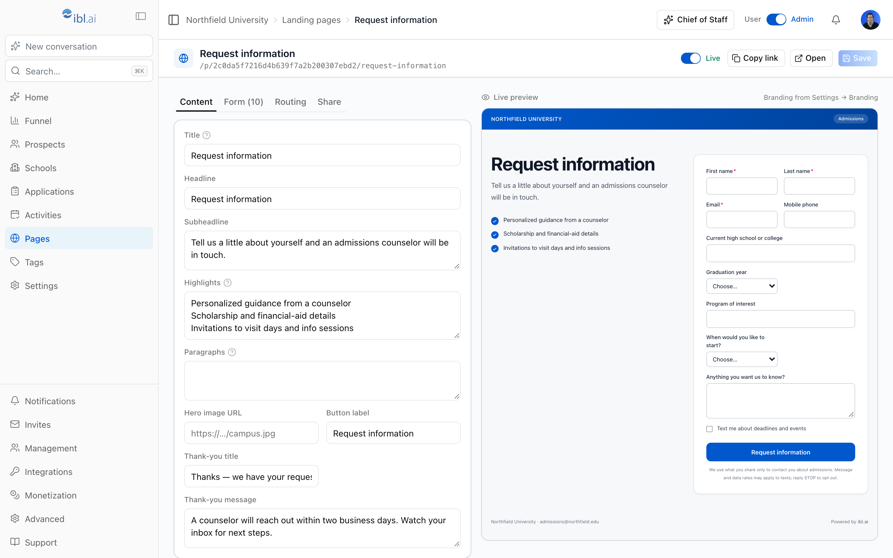<br><sub><b>Landing page editor</b> — with live preview</sub></td>
<td width="50%">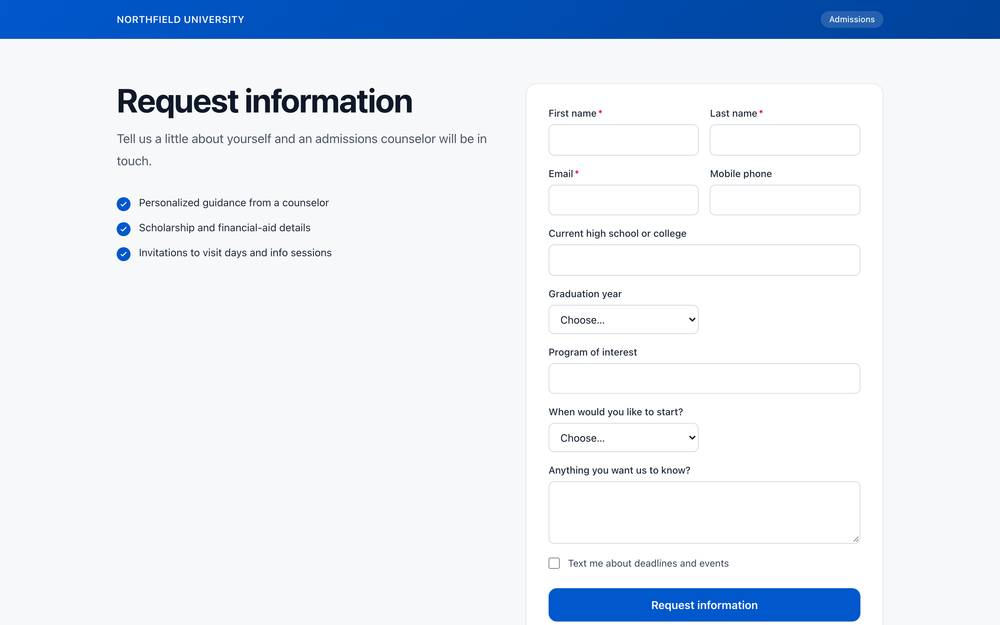<br><sub><b>The public page</b> — as a prospect sees it</sub></td>
</tr>
<tr>
<td width="50%">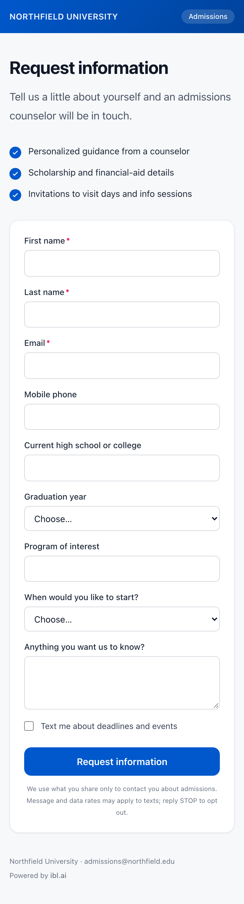<br><sub><b>On a phone</b></sub></td>
<td width="50%">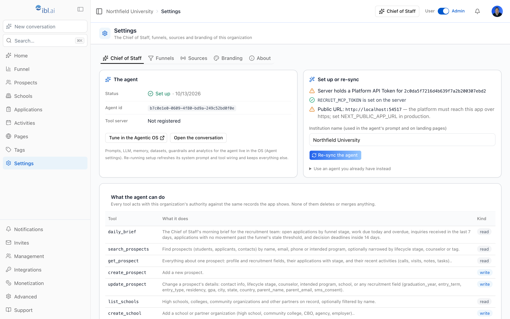<br><sub><b>Settings — Chief of Staff</b> — setup and tools</sub></td>
</tr>
<tr>
<td width="50%">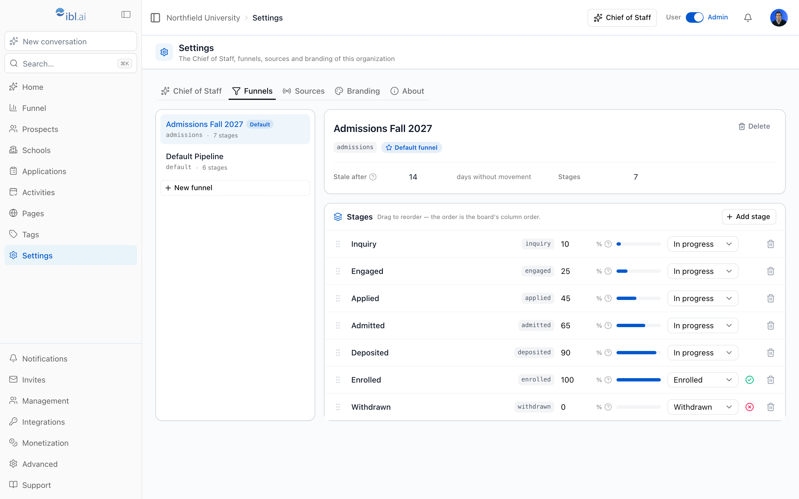<br><sub><b>Settings — Funnels</b> — funnels and stages</sub></td>
<td width="50%">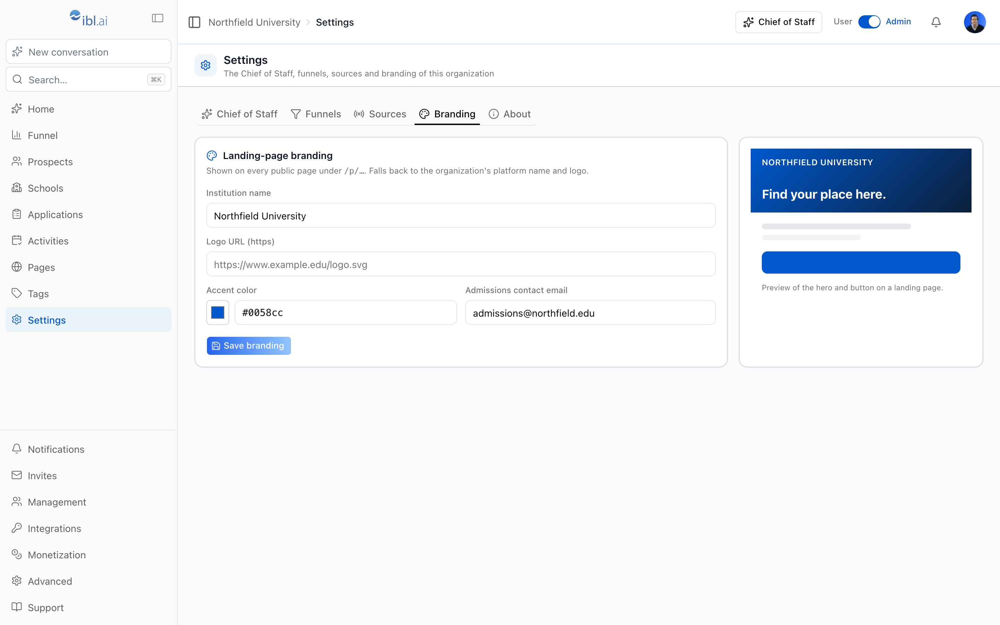<br><sub><b>Settings — Branding</b> — landing-page branding</sub></td>
</tr>
</table>

</div>

---

## Quick Start

```bash
git clone https://github.com/iblai/recruit.git
cd recruit
pnpm install --ignore-scripts
cp .env.example .env.local      # optional overrides; no secrets (see below)
pnpm dev
```

**Using [Claude Code](https://claude.ai/claude-code) or another coding agent?** Read [`AGENTS.md`](AGENTS.md) first; the [iblai/vibe](https://github.com/iblai/vibe) skills (`npx skills add iblai/vibe --all`) document every platform surface this app uses.

Open [http://localhost:3000](http://localhost:3000). You are sent to [login.iblai.app](https://login.iblai.app) to sign in and come back to `/platform/<your-org>`. A user whose only organization is the community one gets its trial-gated shell there, on a sample organization; an admin's first visit opens the setup flow. Then, as an org admin: **Settings → Chief of Staff → Set up**, and **Landing pages → New landing page**. Want sample data to explore? `pnpm seed:demo --org <org-key>` seeds a Fall admissions funnel, sources, tags, three schools, twelve prospects with applications and activities, and a published "Request information" page.

New to ibl.ai? [ibl.ai/join](https://ibl.ai/join) creates your account and your organization. `http://localhost:3000` must be an allowed redirect origin of the organization you sign in to. See the full [Development Guide](docs/development.md) for setup, scripts and verification.

Node.js 22+ and pnpm 12 (`corepack enable` picks the pinned version up from `package.json`). The `dev` script sets `NODE_OPTIONS='--no-experimental-webstorage'` so the SDK's browser-storage guards do not collide with Node's `localStorage`; the CLI scripts run through `tsx`.

### Scripts

| Command                                                                                | What it does                                                                                                                                                                  |
| -------------------------------------------------------------------------------------- | ----------------------------------------------------------------------------------------------------------------------------------------------------------------------------- |
| `pnpm dev`                                                                             | Dev server on port 3000                                                                                                                                                       |
| `pnpm build`                                                                           | Production build (standalone output; the regular output on Vercel)                                                                                                            |
| `pnpm start`                                                                           | Serve the production build                                                                                                                                                    |
| `pnpm typecheck`                                                                       | TypeScript 7                                                                                                                                                                  |
| `pnpm lint`                                                                            | oxlint, zero warnings                                                                                                                                                         |
| `pnpm format`                                                                          | oxfmt (`pnpm format:check` in CI)                                                                                                                                             |
| `pnpm test`                                                                            | Vitest unit tests                                                                                                                                                             |
| `pnpm test:e2e`                                                                        | Playwright journeys (needs `e2e/.env.development`)                                                                                                                            |
| `pnpm e2e:accounts`                                                                    | Once: the two e2e test accounts in a throwaway organization                                                                                                                   |
| `pnpm seed:demo --org <key>`                                                           | Seed a demo recruitment workspace (acts with `TOKEN` from `iblai.env`)                                                                                                        |
| `pnpm screenshots`                                                                     | Capture the README screenshots into `docs/images/`                                                                                                                            |
| `pnpm tauri:dev` / `tauri:build`                                                       | Desktop shell (needs Rust); `pnpm tauri:dev:ios` / `tauri:dev:android` for a simulator or emulator                                                                            |
| `pnpm shell:smoke` / `shell:smoke:windows`                                             | The shell headless against a local page: the navigation guard and both sign-in returns (CI runs the Linux one on every shell change)                                          |
| `pnpm shell:touch` / `shell:touch:windows` / `shell:touch:ios` / `shell:touch:android` | The built shell on this machine (Linux, macOS, Windows), on an iOS simulator or on an Android phone, with the touch-test checklist ([docs](docs/development.md#native-shell)) |
| `pnpm shell:clear` [`android`, `ios`] / `shell:clear:windows`                          | Forgets the shell's cookies, localStorage and caches on this machine, the phone or the simulator, so the next touch test starts signed out                                    |

---

## Deployment

ibl.ai/recruit is a front end for the ibl.ai platform plus the tool server the agent calls; it holds no platform secret. The platform provides sign-in, organizations, roles, notifications, memory, analytics and the CRM API; this repository provides the app.

### Option A: Hosted ibl.ai platform

1. **Build and run with Node** — anywhere Next.js runs:

   ```bash
   pnpm build && PORT=3000 pnpm start
   ```

   On Vercel nothing of this is needed: the project builds the regular Next.js output (`vercel.json` pins the preset) and wants `ENABLE_EXPERIMENTAL_COREPACK=1` so pnpm 12 installs, plus the [Configuration](#configuration) values as project variables — at least `NEXT_PUBLIC_APP_URL` (the public https origin, set before the Chief of Staff setup: the platform calls `/api/mcp/<org>` on it) and `NEXT_PUBLIC_MAIN_TENANT_KEY`.

2. **Or run with Docker**

   ```bash
   docker build -t iblai-recruit . && docker run -p 3000:3000 --env-file .env.local iblai-recruit
   ```

3. **Register the origin.** Every origin the app runs on (`http://localhost:3000`, `https://recruit.example.edu`, the `iblai-recruit://` native scheme) must be an allowed redirect origin of the organizations that sign in. Set `NEXT_PUBLIC_APP_URL` to the public https origin **before** running the Chief of Staff setup — the platform must reach `/api/mcp/<org>` over https.

### Option B: Self-hosted platform

Set the service URLs in `.env.local` (see [Configuration](#configuration)). If you need the full backend, reach out at [ibl.ai/contact](https://ibl.ai/contact) for an enterprise license and deploy it with [iblai/iblai-infra-cli](https://github.com/iblai/iblai-infra-cli).

### Every surface, on your own backend

Ship **Web, macOS, Windows, Linux, iOS and Android** pointed at your own deployment — one web codebase, with the native apps as WebView shells around it:

**→ [Platform deployment guide](docs/platform-deployment.md)** (per-surface build, backend config, release, store submission).

#### Build-time flags (native apps)

The Tauri shell reads two optional compile-time flags (Rust `option_env!`) and exposes them as commands; set them in the build shell before `pnpm tauri build`. The web app does not read these commands yet, so neither flag changes the app today — the organization lock and the in-app purchase UI are coming soon:

| Env var                     | Tauri command                  | Default         | Effect                                                                                         |
| --------------------------- | ------------------------------ | --------------- | ---------------------------------------------------------------------------------------------- |
| `IBL_TENANT`                | `get_locked_tenant` → `string` | `""` (unlocked) | **Organization lock** (coming soon): the organization a build is meant for. Empty = multi-org. |
| `IBL_ALLOW_IN_APP_PURCHASE` | `allow_in_app_purchase` → bool | `false`         | In-app purchase UI (coming soon). Truthy: `1`, `true`, `yes`, `on`.                            |

```bash
IBL_TENANT=acme pnpm tauri build   # a build meant for the "acme" organization
```

---

## Configuration

All browser config is `NEXT_PUBLIC_*` and optional against hosted `iblai.app`; defaults live in [`lib/iblai/config.ts`](lib/iblai/config.ts). There are no server secrets.

| Variable                          | Default                   | Description                                                                                                                      |
| --------------------------------- | ------------------------- | -------------------------------------------------------------------------------------------------------------------------------- |
| `NEXT_PUBLIC_APP_URL`             | request origin            | **Public origin of this deployment** — landing-page links and the URL the platform calls back on for tools (https in production) |
| `NEXT_PUBLIC_MAIN_TENANT_KEY`     | `main`                    | The community organization — the trial-gated shell for a user who belongs to nothing else                                        |
| `NEXT_PUBLIC_DEFAULT_AGENT_ID`    | —                         | Pin the Chief of Staff at build time instead of reading it from the org's metadata                                               |
| `NEXT_PUBLIC_API_BASE_URL`        | `https://api.iblai.app`   | Consolidated API; `/dm` (CRM), `/lms`, `/axd` derive from it                                                                     |
| `NEXT_PUBLIC_AUTH_URL`            | `https://login.iblai.app` | The hosted Auth SPA                                                                                                              |
| `NEXT_PUBLIC_OS_URL`              | `https://os.ibl.ai`       | Where "Tune in the Agentic OS" links go                                                                                          |
| `NEXT_PUBLIC_TAURI_CUSTOM_SCHEME` | `iblai-recruit`           | Deep-link scheme the native shells return through after SSO                                                                      |
| `NEXT_PUBLIC_DEFAULT_CURRENCY`    | `USD`                     | Currency preselected on new applications                                                                                         |

---

## Architecture

```
recruit/
├── app/
│   ├── layout.tsx                        # bare root (html/body); two route groups below
│   ├── (app)/                            # the signed-in workspace — ibl.ai providers
│   │   ├── page.tsx                      # `/` → /platform/<session org>
│   │   ├── platform/[tenantKey]/
│   │   │   ├── layout.tsx                # sidebar · top bar · Chief of Staff side panel · admin gate
│   │   │   ├── page.tsx                  # Home: Chief of Staff conversation + today's brief
│   │   │   ├── dashboard/                # Funnel dashboard
│   │   │   ├── prospects/ · schools/     # lists + record pages
│   │   │   ├── applications/             # board · table · application page
│   │   │   ├── activities/ · tags/
│   │   │   ├── landing-pages/[slug]      # list · editor with live preview
│   │   │   ├── settings/                 # Chief of Staff · Funnels · Sources · Branding · About
│   │   │   ├── notifications/ · admin/users/
│   │   └── sso-login-complete/ · mobile-sso-login/ · error/
│   ├── (public)/p/[tenantKey]/[slug]/    # prospect-facing landing pages — no session, no SDK
│   └── api/
│       ├── mcp/[tenantKey]/              # the Chief of Staff's tool server (MCP, Streamable HTTP)
│       ├── admin/agent/                  # agent setup (org admins)
│       └── auth-redirect/
├── components/
│   ├── crm/                              # sidebar, top bar, ⌘K, tables, boards, dialogs, record widgets
│   ├── recruit/                          # chief-of-staff (chat, brief, panel, setup), landing-pages, settings
│   ├── landing/                          # the public page view + the form (preview only for now)
│   └── ui/                               # shadcn/ui (Base UI) primitives
├── lib/
│   ├── crm/                              # CRM types · RTK Query slice · formatting (API nouns)
│   ├── recruit/                          # vocabulary · fields · landing pages · agent · org settings · server CRM client
│   ├── mcp/                              # protocol (JSON-RPC / Streamable HTTP) · tools
│   └── iblai/                            # config · tenant · auth · platform (server)
├── scripts/                              # seed-demo.ts · screenshots.mjs
├── src-tauri/                            # Tauri 2 shell (macOS · Windows · Linux · iOS · Android)
├── e2e/ · __tests__/                     # Playwright journeys · Vitest
└── docs/                                 # chief-of-staff.md · landing-pages.md · development.md · platform-deployment.md
```

### Data flow

```
Team member ─► React pages ─► RTK Query (lib/crm/api.ts) ─► api.iblai.app/dm/api/crm/…   Authorization: Token <dm_token>
            └► SDK <Chat> ─► ibl.ai agent runtime ─► POST /api/mcp/<org> (Bearer <recruit-tools key>)
                                                        └► lib/mcp/tools.ts ─► CrmServer (Api-Token <same key>) ─► …/dm/api/crm/…
Prospect ───► /p/<org>/<slug> (server-rendered page; the form is off)
```

Sign-in is the platform's hosted round trip; `TenantProvider` re-authenticates when the organization in the URL differs from the session's. The CRM API infers the organization from the token, so everything you see belongs to the organization in the URL. The app's own settings — the agent id, the landing pages, branding — live under `apps.recruit` in the organization's public metadata object (GET → merge → PUT), so no database of our own.

---

## Testing

This project is covered by Vitest unit tests in [`__tests__/`](__tests__/) and Playwright end-to-end journeys in [`e2e/`](e2e/). **Run the journeys for any change** so nothing regresses:

| Command                            | What it does                                                                                                               |
| ---------------------------------- | -------------------------------------------------------------------------------------------------------------------------- |
| `pnpm test`                        | Vitest — config, organization resolution, SSO landing, the CRM client, the tool server, landing pages, the house journeys  |
| `pnpm shell:smoke`                 | The Tauri shell headless (`shell:smoke:windows` on Windows): the navigation guard and both sign-in returns on a local page |
| `pnpm e2e:accounts`                | Once: an organization admin and a member in the throwaway organization `iblai.env` names                                   |
| `pnpm test:e2e`                    | Playwright journeys (auth, shell, recruit, sample, house) in Chromium, Firefox and WebKit                                  |
| `pnpm test:e2e --project=chromium` | The same journeys in one browser                                                                                           |
| `pnpm test:e2e:ui`                 | Interactive UI mode                                                                                                        |
| `pnpm test:e2e:headed`             | Run with a visible browser                                                                                                 |

See [e2e/COVERAGE.md](e2e/COVERAGE.md) for current coverage. Coverage must not regress — add or update a journey whenever you change user-facing behavior.

The Playwright suite signs in once per browser through the real Auth SPA (`e2e/auth.setup.ts`) as the two accounts `pnpm e2e:accounts` creates — an organization admin and a member — in a throwaway organization, never `main`: `--org` or `PLATFORM` in `iblai.env`. The script asks for that organization's Platform API key, checks the key belongs to it, keeps it nowhere and prints usernames only; the pair lands in the gitignored `e2e/.env.development`, which is never read or printed. `e2e/coverage.json` is the checkpoint list and `e2e/COVERAGE.md` its readable twin; keep them in sync when user-facing behavior changes.

---

## Contributing

We welcome contributions! See [CONTRIBUTING.md](CONTRIBUTING.md). If you use AI-assisted tooling, read [AGENTS.md](AGENTS.md) first — it explains the admissions vocabulary, the rules and where things are.

---

## Resources

- [Documentation](https://ibl.ai/docs)
- [Development Guide](docs/development.md) — setup, scripts, verification
- [docs/chief-of-staff.md](docs/chief-of-staff.md) — the agent, its tools, the setup, troubleshooting
- [docs/landing-pages.md](docs/landing-pages.md) — building, publishing, mapping, why the form is off
- [Agentic OS](https://github.com/iblai/os) · [CRM](https://github.com/iblai/crm) — the sibling apps this one mirrors; the CRM is the general-purpose sibling
- [Vibe](https://github.com/iblai/vibe) — the skills and SDK toolkit this app is built with
- [@iblai/iblai-js](https://www.npmjs.com/package/@iblai/iblai-js) — the ibl.ai SDK

---

<div align="center">

## License

MIT License. See [LICENSE](LICENSE) for details.

<br>

**[ibl.ai](https://ibl.ai)** · Your organization's AI, under your control.

</div>
