<div align="center">

<a href="https://ibl.ai"></a>

# ibl.ai/recruit

**The open-source recruitment CRM for universities — run by a Chief of Staff agent.**

One agent your whole admissions team talks to. Prospects, schools, applications, activities and tags in the shape of a modern CRM. Landing pages that turn a QR code at a college fair into a prospect in your funnel. Built on the [ibl.ai](https://ibl.ai) platform with [iblai/vibe](https://github.com/iblai/vibe).

[](https://ibl.ai/join)
[](https://github.com/iblai/vibe)
[](LICENSE)
[](https://ibl.ai)
[](https://nextjs.org)
[](https://tauri.app)

[Why](#why-iblairecruit) · [The Chief of Staff](#the-chief-of-staff) · [The CRM](#the-crm-admissions-words-on-a-modern-crm) · [Landing pages](#landing-pages) · [Quick start](#quick-start) · [Configuration](#configuration) · [Architecture](#architecture)

</div>

---

## Why ibl.ai/recruit

|                                  |                                                                                                                                                                                                                                                                                 |
| -------------------------------- | ------------------------------------------------------------------------------------------------------------------------------------------------------------------------------------------------------------------------------------------------------------------------------- |
| 🧭 **An agent, not a dashboard** | Home is a conversation. The **Chief of Staff** knows every prospect, school and application, briefs the team each morning, logs the calls, moves the applications, drafts the outreach and builds the landing pages — through tools, against the same records the screens show. |
| 🗂️ **A real CRM underneath**     | A modern CRM's information architecture — objects in a sidebar, table and kanban views, record pages with a timeline — on the ibl.ai CRM API, in admissions vocabulary: prospects, schools, applications in funnels, counselors.                                                |
| 🌐 **Prospect-facing pages**     | Publish "Request information" or event pages at `/p/<org>/<slug>`: fast, server-rendered, no sign-in. Every submission lands as a prospect — with an application in the funnel, tags and a note.                                                                                |
| 🔓 **Your code, your data**      | MIT-licensed and self-hostable. Records live in your ibl.ai organization, scoped by the platform's multi-tenancy — no second database. SSO, roles, notifications, memory, analytics and billing come from the platform.                                                         |
| 📱 **Everywhere**                | One codebase ships as web, macOS, Windows, Linux, iOS and Android (Tauri 2 shells), exactly like [iblai/os](https://github.com/iblai/os) and [iblai/crm](https://github.com/iblai/crm).                                                                                         |

---

## The Chief of Staff

Every member of the recruitment team — counselors, recruiters, operations, the director — works through one agent. It is an ordinary ibl.ai agent (prompts, LLM, memory, guardrails and analytics are tuned in the Agentic OS) with one addition: this app exposes a **tool server** the agent calls, so what it looks up and changes is what the team sees.

```
"Give me today's brief."
"Who in Admitted hasn't deposited, and when did we last talk to them?"
"Log that I toured campus with Priya Natarajan on Tuesday and schedule a follow-up for Friday."
"Draft a warm email to the Fall 2027 admits from Lincoln High who haven't deposited."
"Create a landing page for the Nursing open house — Fall 2027, tag Web inquiry."
```

**What it can do** (every tool acts with the CRM User role, or as the admin who last ran setup where RBAC is off; none deletes or merges):

| Area          | Tools                                                                                                                                  |
| ------------- | -------------------------------------------------------------------------------------------------------------------------------------- |
| The brief     | `daily_brief` — open applications by stage, due today / overdue, inquiries this week, stale applications, deadlines                    |
| Prospects     | `search_prospects`, `get_prospect`, `create_prospect`, `update_prospect`                                                               |
| Schools       | `list_schools`, `create_school`                                                                                                        |
| Applications  | `list_funnels`, `list_applications`, `create_application`, `move_application`, `mark_enrolled`, `mark_withdrawn`, `update_application` |
| Activities    | `log_activity`, `list_tasks`, `complete_task`                                                                                          |
| Tags & team   | `list_tags`, `tag_record`, `list_team`                                                                                                 |
| Landing pages | `list_landing_pages`, `create_landing_page` (drafts stay unpublished until a human reviews them)                                       |

**Where it lives:** Home (`/platform/<org>`) is the full conversation with today's brief beside it; a **Chief of Staff** button in the top bar opens the same agent in a side panel on every other page.

**Setup:** an org admin opens _Settings → Chief of Staff_ and clicks once. Acting as that admin, the server creates the agent, registers this deployment's tool server (`/api/mcp/<org>`, MCP over Streamable HTTP), mints the `recruit-tools` Platform API Token (scoped to the CRM User role where the platform enforces RBAC) and stores it in a platform-scoped connection (the platform presents it on every tool call; this app keeps no copy), wires `mcp-tool` + the server onto the agent, adds suggested prompts, and records the agent id in the organization's metadata so every member's app finds it. Re-running re-syncs the prompt and wiring, rotates the key and keeps everything else. Details: [docs/chief-of-staff.md](docs/chief-of-staff.md).

---

## The CRM: admissions words on a modern CRM

The platform's CRM API speaks sales; the app keeps those names in code and shows admissions language everywhere a human reads it ([`lib/recruit/vocabulary.ts`](lib/recruit/vocabulary.ts)):

| CRM API (code)        | ibl.ai/recruit (UI)                                      |
| --------------------- | -------------------------------------------------------- |
| Person                | **Prospect** — a student, applicant or school contact    |
| Organization          | **School** — high school, college, CBO, agency, employer |
| Deal                  | **Application** — one prospect × one program and term    |
| Pipeline / Stage      | **Funnel** / Stage (stable codes, e.g. `applied`)        |
| Lead source           | **Source** (college fair, school visit, landing page…)   |
| Owner                 | **Counselor**                                            |
| Won / Lost            | **Enrolled** / **Withdrawn** (with a reason)             |
| `lead_value`          | **Est. net tuition** (optional)                          |
| `expected_close_date` | **Decision deadline**                                    |
| `lifecycle_stage`     | Inquiry → Engaged → Applicant → Enrolled · Withdrawn     |

Recruitment fields the API has no column for — graduation year, entry term, entry type, residency, GPA, parent contact, SMS consent on prospects; program, term, entry type, financial aid, scholarship on applications; type on schools — live in each record's `metadata`, defined once in [`lib/recruit/fields.ts`](lib/recruit/fields.ts) and shared by the dialogs, the record pages, the agent's tools and the landing-page mapping.

**Screens:** Funnel dashboard (tiles, applications by stage, enrolled vs withdrawn, up next) · Prospects table and record page (details, recruitment fields, timeline, applications, invite / link / merge) · Schools & partners · Applications board (drag between stages, stale and deadline badges) and table · Application page (stage stepper, enrolled / withdrawn, fields, timeline) · Activities (overdue / today / week) · Tags · Landing pages · Settings (Chief of Staff, Funnels, Sources, Branding, About) · ⌘K. The sidebar is the SDK's cross-app `PlatformSidebar`, the same shell as os.ibl.ai: the organization's own logo in the header and the OS footer cluster (Notifications, Invites, Management, Integrations, Monetization, Advanced, Support) opening the platform's organization sheets in place.

---

## Landing pages

Admins build pages in _Landing pages_: copy, highlights, hero image, the form's questions (each mapped to where its answer lands — name, email, phone, school, program, term, graduation year, consent, or "keep as extra field"), and routing (which funnel and stage the application opens in, the source code, tags, the counselor who owns submissions). A live preview shows the page with its form; **Publish** flips the page live at `/p/<org>/<slug>`; _Share_ gives the link, UTM guidance and an embed snippet.

Each page is a CRM web form on the platform. A visitor's answers go straight to its public endpoint, which reuses the prospect with that email or creates one, opens the application, tags both and logs a note of the answers — with no credential in this app. Identical answers within ten minutes count once, a honeypot drops bots, and the list counts each page's submissions. The pages are plain server-rendered React: no session, no SDK bundle. Details: [docs/landing-pages.md](docs/landing-pages.md).

---

## Screenshots

Captured from a demo organization ("Northfield University", seeded with `pnpm seed:demo`). Regenerate with `pnpm screenshots`.

<div align="center">

**Home — the Chief of Staff, with today's brief beside it**

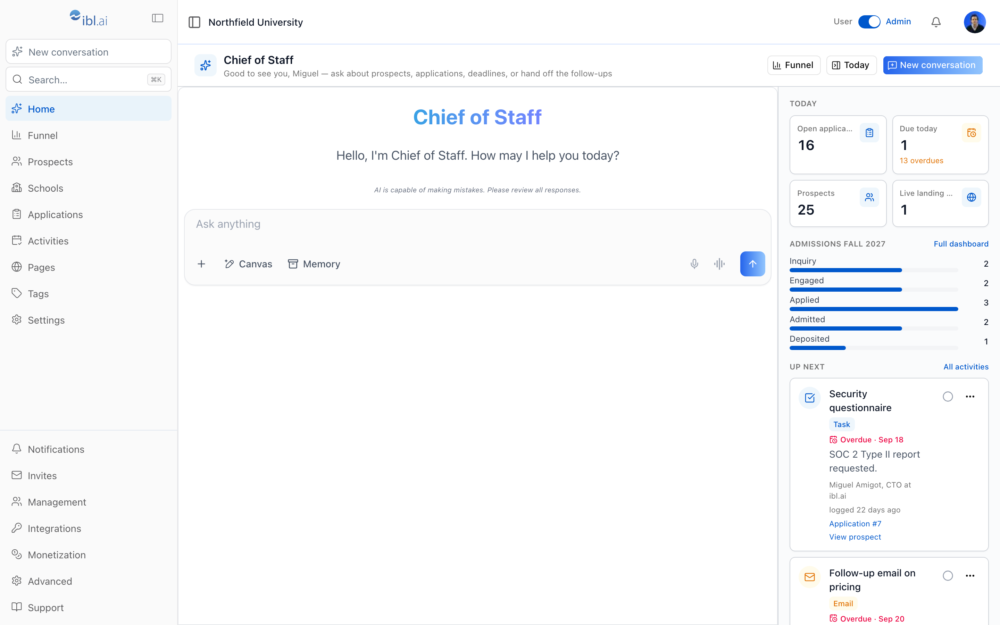

**The Chief of Staff follows you to every page as a side panel**

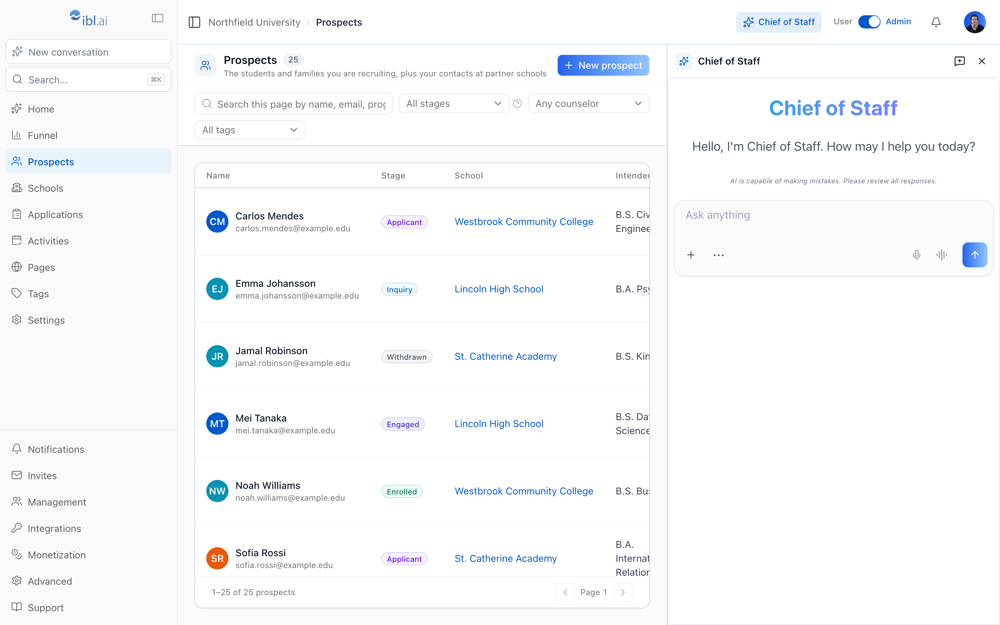

**Funnel dashboard**

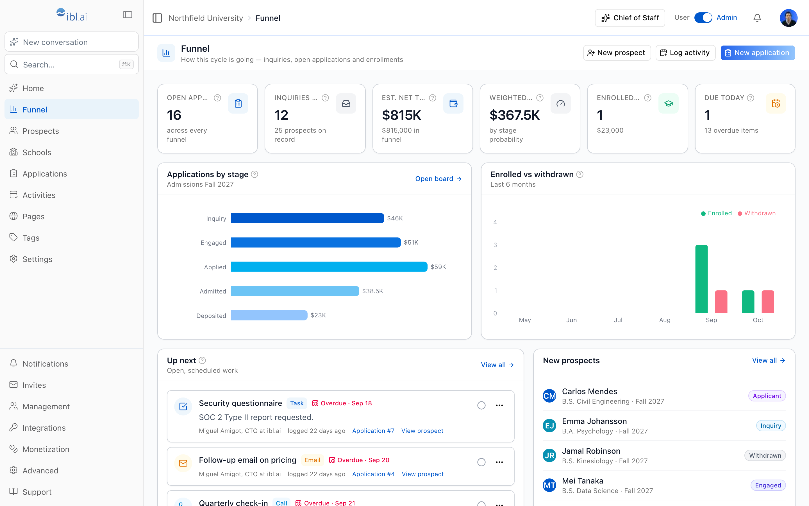

**Applications — board and table**

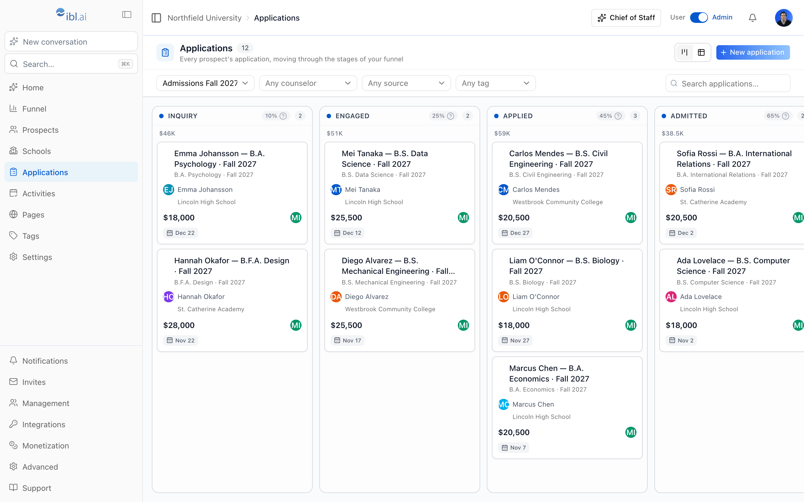

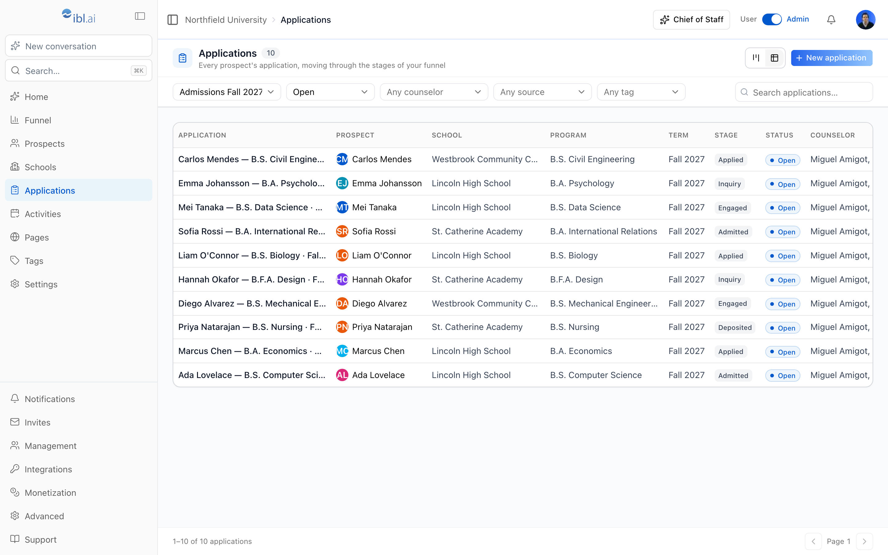

**An application: stage stepper, enrolled / withdrawn, recruitment fields, timeline**

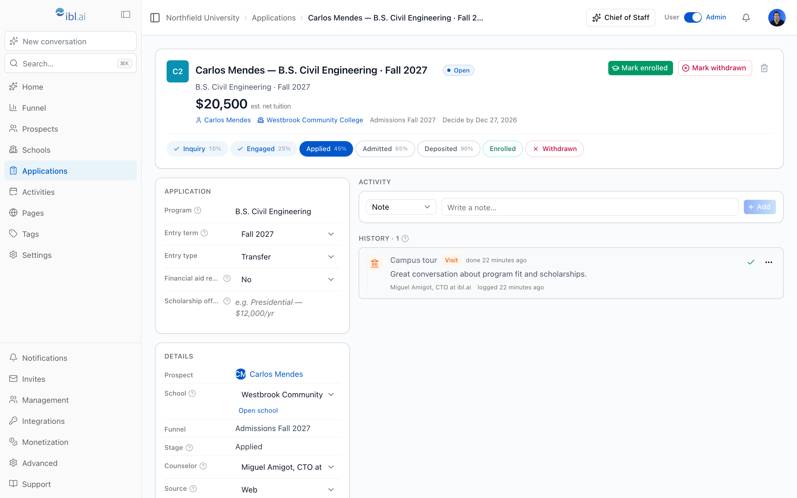

**Prospects and a prospect record**

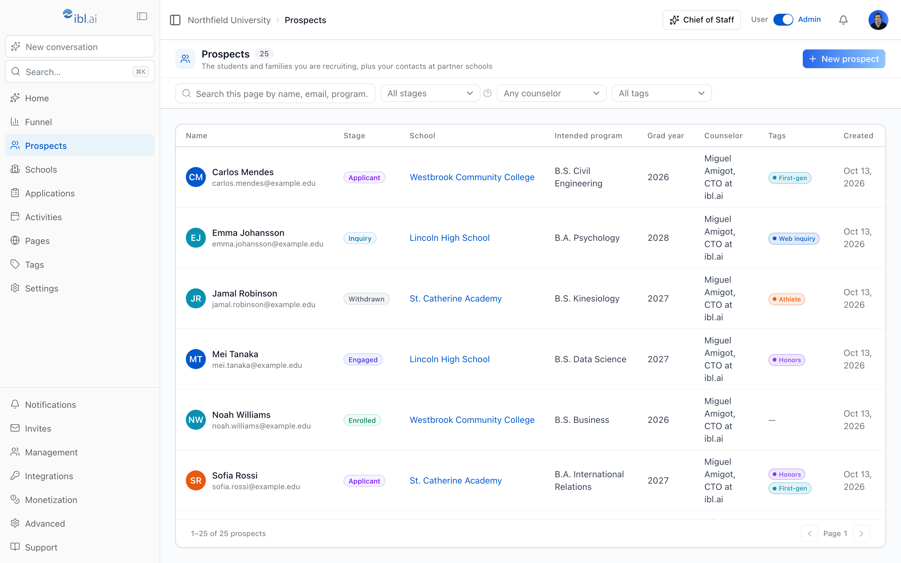

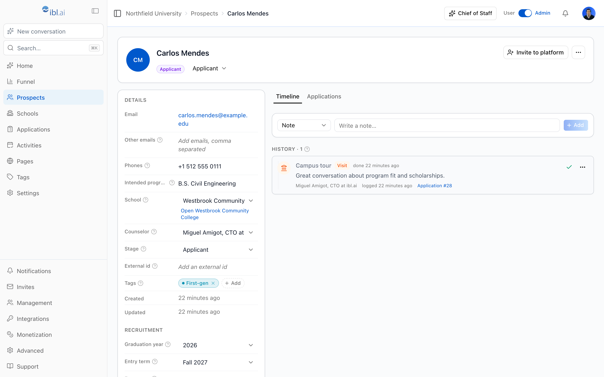

**Schools & partners · Activities**

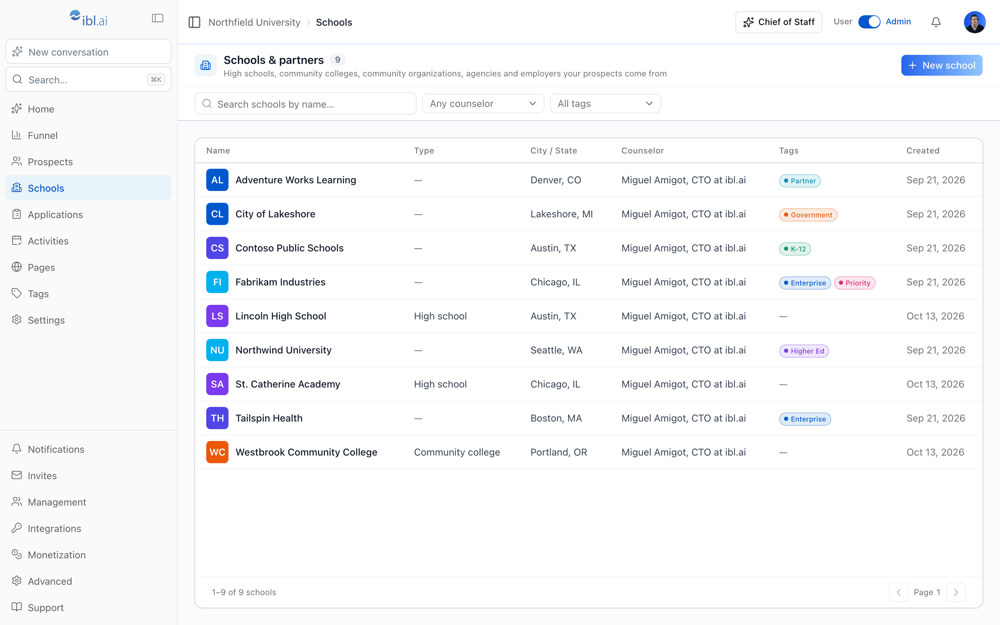

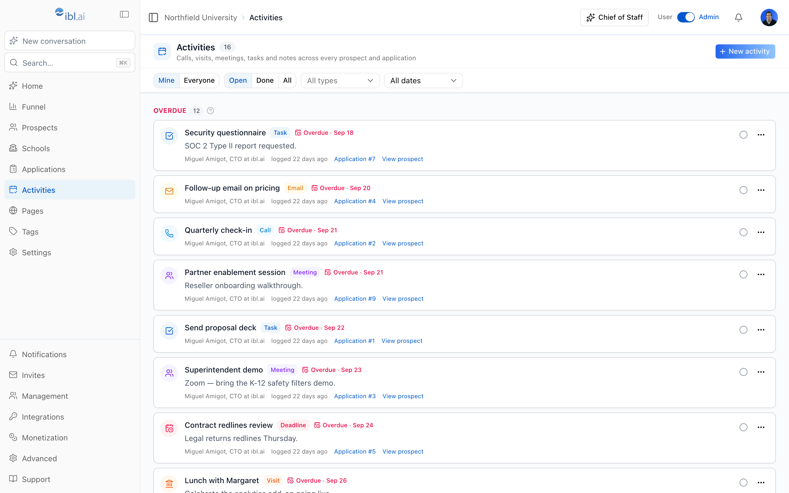

**Landing pages — list, editor with live preview, and the public page**

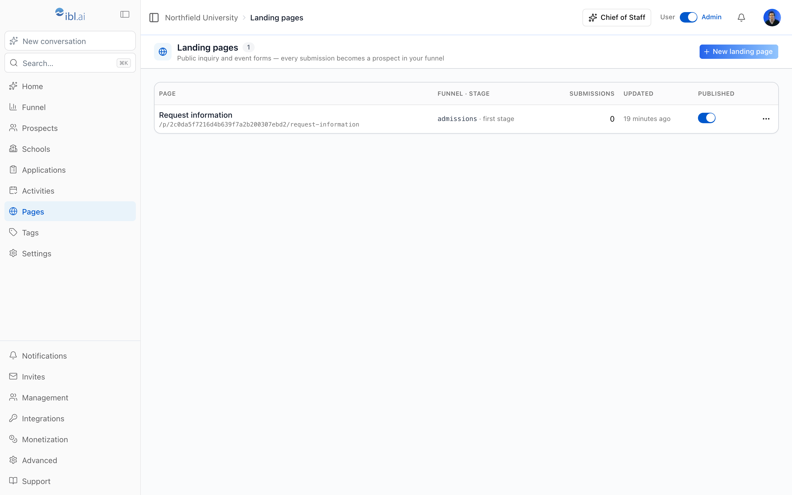

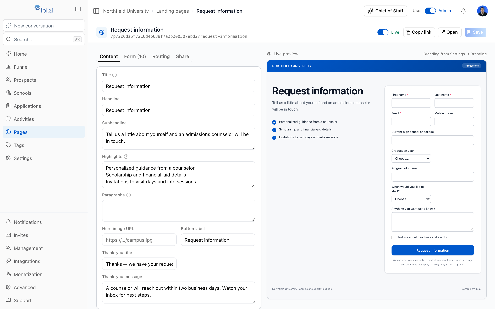

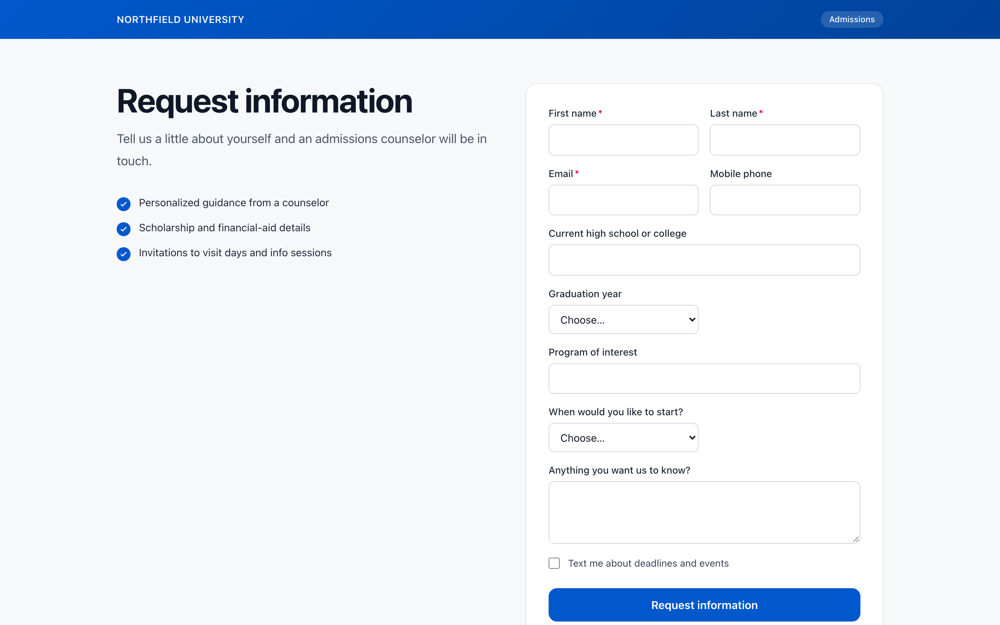

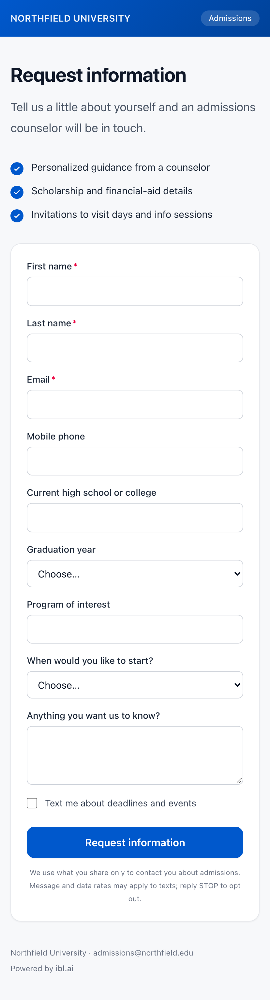

**Settings — Chief of Staff, Funnels, Branding**

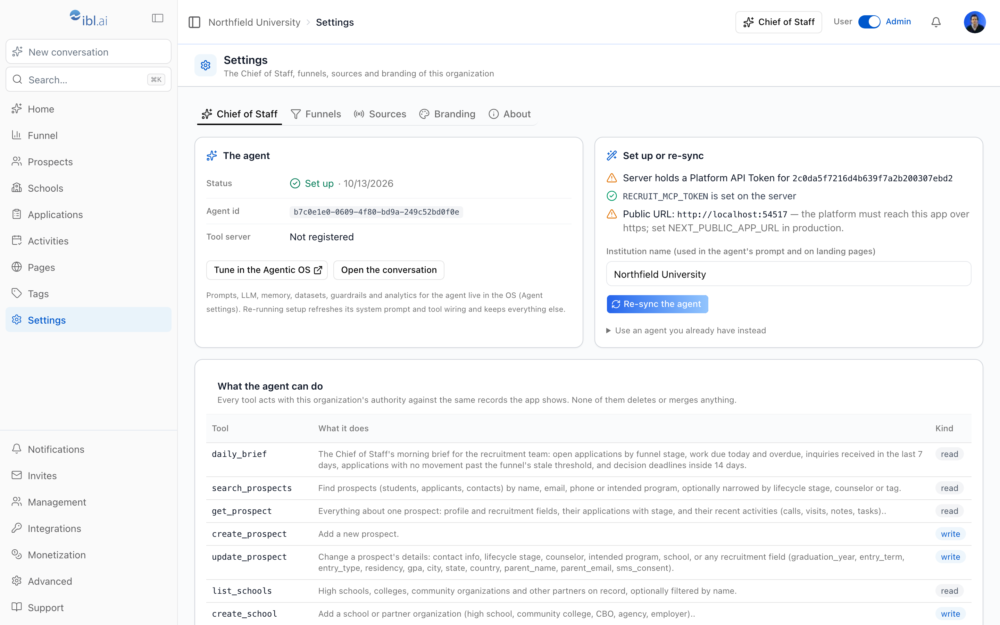

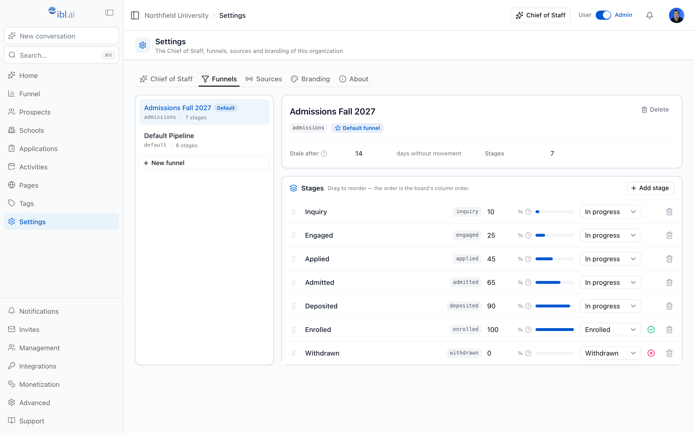

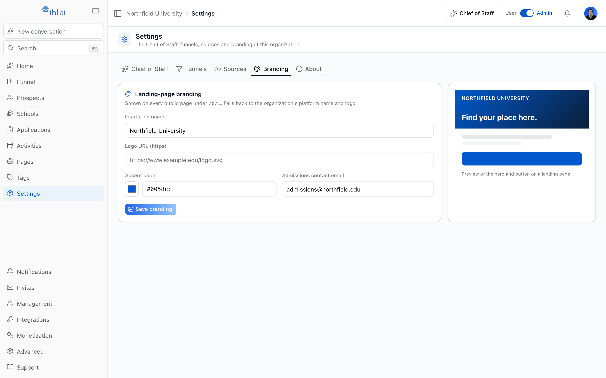

</div>

---

## Quick start

```bash
git clone https://github.com/iblai/recruit.git
cd recruit
pnpm install --ignore-scripts
cp .env.example .env.local      # optional overrides; no secrets (see below)
pnpm dev
```

Open [http://localhost:3000](http://localhost:3000). You are sent to [login.iblai.app](https://login.iblai.app) to sign in and come back to `/platform/<your-org>`. Then, as an org admin: **Settings → Chief of Staff → Set up**, and **Landing pages → New landing page**. Want sample data to explore? `pnpm seed:demo --org <org-key>` seeds a Fall admissions funnel, sources, tags, three schools, twelve prospects with applications and activities, and a published "Request information" page.

New to ibl.ai? [ibl.ai/join](https://ibl.ai/join) creates your account and your organization. `http://localhost:3000` must be an allowed redirect origin of the organization you sign in to.

Node.js 22+ and pnpm 12 (`corepack enable` picks the pinned version up from `package.json`). The `dev` script sets `NODE_OPTIONS='--no-experimental-webstorage'` so the SDK's browser-storage guards do not collide with Node's `localStorage`; the CLI scripts run through `tsx`.

**Using [Claude Code](https://claude.ai/claude-code) or another coding agent?** Read [`AGENTS.md`](AGENTS.md) first; the [iblai/vibe](https://github.com/iblai/vibe) skills (`npx skills add iblai/vibe --all`) document every platform surface this app uses.

### Scripts

| Command                                       | What it does                                                                  |
| --------------------------------------------- | ----------------------------------------------------------------------------- |
| `pnpm dev`                                    | Dev server on port 3000                                                       |
| `pnpm build` / `pnpm start`                   | Production build (standalone output; the regular output on Vercel) / serve it |
| `pnpm typecheck` · `lint` · `format` · `test` | TypeScript 7 · oxlint, zero warnings · oxfmt (`format:check` in CI) · Vitest  |
| `pnpm test:e2e`                               | Playwright journeys (needs `e2e/.env.development`)                            |
| `pnpm seed:demo --org <key>`                  | Seed a demo recruitment workspace (acts with `TOKEN` from `iblai.env`)        |
| `pnpm tauri dev` / `build`                    | Desktop shell (needs Rust); `pnpm tauri ios dev` for the simulator            |

---

## Configuration

All browser config is `NEXT_PUBLIC_*` and optional against hosted `iblai.app`; defaults live in [`lib/iblai/config.ts`](lib/iblai/config.ts). There are no server secrets.

| Variable                          | Default                   | Description                                                                                                                      |
| --------------------------------- | ------------------------- | -------------------------------------------------------------------------------------------------------------------------------- |
| `NEXT_PUBLIC_APP_URL`             | request origin            | **Public origin of this deployment** — landing-page links and the URL the platform calls back on for tools (https in production) |
| `NEXT_PUBLIC_MAIN_TENANT_KEY`     | `main`                    | The community organization — the default when nothing else resolves                                                              |
| `NEXT_PUBLIC_DEFAULT_AGENT_ID`    | —                         | Pin the Chief of Staff at build time instead of reading it from the org's metadata                                               |
| `NEXT_PUBLIC_API_BASE_URL`        | `https://api.iblai.app`   | Consolidated API; `/dm` (CRM), `/lms`, `/axd` derive from it                                                                     |
| `NEXT_PUBLIC_AUTH_URL`            | `https://login.iblai.app` | The hosted Auth SPA                                                                                                              |
| `NEXT_PUBLIC_OS_URL`              | `https://os.ibl.ai`       | Where "Tune in the Agentic OS" links go                                                                                          |
| `NEXT_PUBLIC_TAURI_CUSTOM_SCHEME` | `iblai-recruit`           | Deep-link scheme the native shells return through after SSO                                                                      |
| `NEXT_PUBLIC_DEFAULT_CURRENCY`    | `USD`                     | Currency preselected on new applications                                                                                         |

---

## Deployment

ibl.ai/recruit is a front end for the ibl.ai platform plus the tool server the agent calls; it holds no platform secret. Deploy it anywhere Next.js runs:

```bash
pnpm build && PORT=3000 pnpm start          # or: docker build -t iblai-recruit . && docker run -p 3000:3000 --env-file .env.local iblai-recruit
```

On Vercel nothing of this is needed: the project builds the regular Next.js output (`vercel.json` pins the preset) and wants `ENABLE_EXPERIMENTAL_COREPACK=1` so pnpm 12 installs, plus the [Configuration](#configuration) values as project variables — at least `NEXT_PUBLIC_APP_URL` (the public https origin, set before the Chief of Staff setup: the platform calls `/api/mcp/<org>` on it) and `NEXT_PUBLIC_MAIN_TENANT_KEY`.

Register every origin the app runs on (`http://localhost:3000`, `https://recruit.example.edu`, `iblai-recruit://`) as an allowed redirect origin of the organizations that sign in. Set `NEXT_PUBLIC_APP_URL` to the public https origin **before** running the Chief of Staff setup — the platform must reach `/api/mcp/<org>` over https. Self-hosting the platform itself: [docs/platform-deployment.md](docs/platform-deployment.md).

---

## Architecture

```
recruit/
├── app/
│   ├── layout.tsx                        # bare root (html/body); two route groups below
│   ├── (app)/                            # the signed-in workspace — ibl.ai providers
│   │   ├── page.tsx                      # `/` → /platform/<session org>
│   │   ├── platform/[tenantKey]/
│   │   │   ├── layout.tsx                # sidebar · top bar · Chief of Staff side panel · admin gate
│   │   │   ├── page.tsx                  # Home: Chief of Staff conversation + today's brief
│   │   │   ├── dashboard/                # Funnel dashboard
│   │   │   ├── prospects/ · schools/     # lists + record pages
│   │   │   ├── applications/             # board · table · application page
│   │   │   ├── activities/ · tags/
│   │   │   ├── landing-pages/[slug]      # list · editor with live preview
│   │   │   ├── settings/                 # Chief of Staff · Funnels · Sources · Branding · About
│   │   │   ├── notifications/ · admin/users/
│   │   └── sso-login-complete/ · mobile-sso-login/ · error/
│   ├── (public)/p/[tenantKey]/[slug]/    # prospect-facing landing pages — no session, no SDK
│   └── api/
│       ├── mcp/[tenantKey]/              # the Chief of Staff's tool server (MCP, Streamable HTTP)
│       ├── admin/agent/                  # agent setup (org admins)
│       └── auth-redirect/
├── components/
│   ├── crm/                              # sidebar, top bar, ⌘K, tables, boards, dialogs, record widgets
│   ├── recruit/                          # chief-of-staff (chat, brief, panel, setup), landing-pages, settings
│   ├── landing/                          # the public page view + the form (preview only for now)
│   └── ui/                               # shadcn/ui (Base UI) primitives
├── lib/
│   ├── crm/                              # CRM types · RTK Query slice · formatting (API nouns)
│   ├── recruit/                          # vocabulary · fields · landing pages · agent · org settings · server CRM client
│   ├── mcp/                              # protocol (JSON-RPC / Streamable HTTP) · tools
│   └── iblai/                            # config · tenant · auth · platform (server)
├── scripts/                              # seed-demo.ts · screenshots.mjs
├── src-tauri/                            # Tauri 2 shell (macOS · Windows · Linux · iOS · Android)
├── e2e/ · __tests__/                     # Playwright journeys · Vitest
└── docs/                                 # chief-of-staff.md · landing-pages.md · development.md · platform-deployment.md
```

### Data flow

```
Team member ─► React pages ─► RTK Query (lib/crm/api.ts) ─► api.iblai.app/dm/api/crm/…   Authorization: Token <dm_token>
            └► SDK <Chat> ─► ibl.ai agent runtime ─► POST /api/mcp/<org> (Bearer <recruit-tools key>)
                                                        └► lib/mcp/tools.ts ─► CrmServer (Api-Token <same key>) ─► …/dm/api/crm/…
Prospect ───► /p/<org>/<slug> (server-rendered page; the form is off)
```

Sign-in is the platform's hosted round trip; `TenantProvider` re-authenticates when the organization in the URL differs from the session's. The CRM API infers the organization from the token, so everything you see belongs to the organization in the URL. The app's own settings — the agent id, the landing pages, branding — live under `apps.recruit` in the organization's public metadata object (GET → merge → PUT), so no database of our own.

---

## Resources

- [docs/chief-of-staff.md](docs/chief-of-staff.md) — the agent, its tools, the setup, troubleshooting
- [docs/landing-pages.md](docs/landing-pages.md) — building, publishing, mapping, why the form is off
- [docs/development.md](docs/development.md) — setup, scripts, verification
- [iblai/vibe](https://github.com/iblai/vibe) — the skills and SDK toolkit this app is built with · [iblai/crm](https://github.com/iblai/crm) — the general-purpose sibling

<div align="center">

## License

MIT License. See [LICENSE](LICENSE).

**[ibl.ai](https://ibl.ai)** · Your organization's AI, under your control.

</div>
